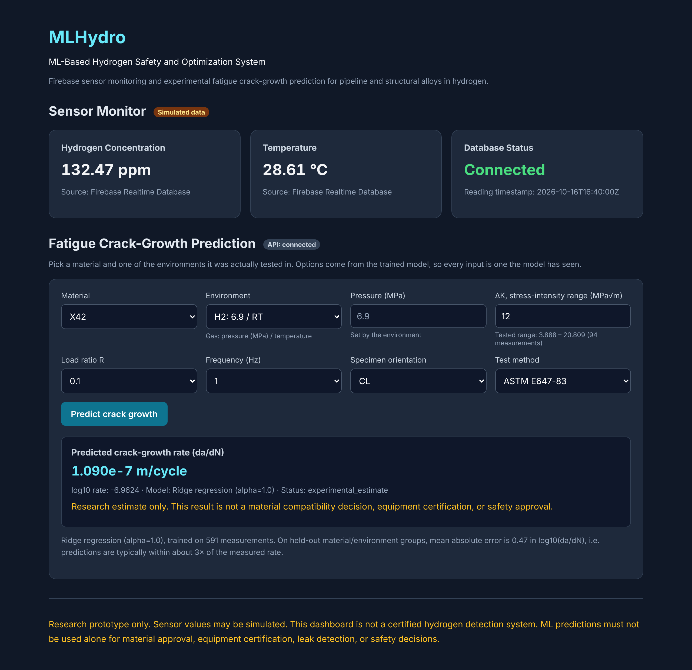
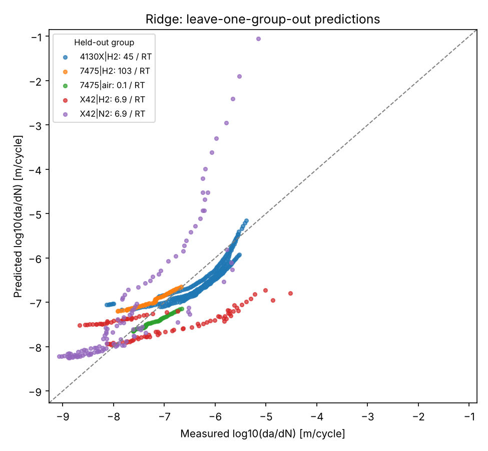

# MLHydro: Hydrogen Embrittlement Fatigue Predictor

Predicts how fast fatigue cracks grow in pipeline and structural alloys exposed to
high-pressure hydrogen, from published test data. Includes a FastAPI prediction
service and a web dashboard with a Firebase-backed hydrogen sensor monitor.



> **Research prototype.** Predictions are exploratory estimates, not material
> qualification, equipment certification, or safety decisions.

## What it does

- **Data pipeline:** extracts fatigue crack-growth (da/dN vs ΔK) and fracture-toughness
  measurements from the Sandia *Technical Reference for Hydrogen Compatibility of
  Materials* workbooks for three alloys: **X42** line-pipe steel, **4130X** pressure-vessel
  steel and **7475** aluminium.
- **Model:** a scikit-learn pipeline (imputation, scaling, one-hot encoding, Ridge
  regression) predicting log₁₀(da/dN) from material, environment, gas pressure, ΔK,
  load ratio R, frequency, orientation and test method.
- **Validation:** leave-one-group-out cross-validation that holds out a whole
  material/environment combination at a time, so the score reflects conditions the model
  has never seen.
- **API:** FastAPI service with request validation that **rejects conditions outside the
  training data** and flags extrapolated inputs (for example, ΔK outside the tested range).
- **Dashboard:** dropdowns built from the model's tested conditions, plus a live sensor
  panel reading `sensor_data/latest` from Firebase Realtime Database.

## Results

591 measurements, 5 material/environment groups. Errors are in log₁₀(da/dN), so an MAE of
0.47 means predictions are typically within about **3×** of the measured rate.

| Model (leave-one-group-out) | Mean MAE | Mean RMSE | Mean R² |
|---|---|---|---|
| Baseline (predict training mean) | 0.83 | 0.93 | −1.66 |
| **Ridge regression** (deployed) | **0.47** | **0.59** | 0.13 |
| Random Forest | 0.49 | 0.59 | 0.19 |

Ridge cuts the baseline error by **44%** on unseen conditions. It was chosen over Random
Forest for similar accuracy, more stable behaviour across folds, and a model that is easy
to inspect. Per-fold scores are in `ml/data/processed/group_cv_results.csv`.



### What the data shows

- **Hydrogen accelerates crack growth in X42 steel:** about 40× faster in 6.9 MPa H₂ than
  in N₂ at ΔK = 12 MPa√m. The model captures the direction (about 13×) but underestimates
  the size of the effect.
- **7475 aluminium is barely affected:** in this data its cracks grow slightly *slower* in
  dry 103 MPa H₂ than in lab air, consistent with aluminium alloys' known resistance to
  gaseous hydrogen.

### Limitations

- **Material and environment are confounded.** Each alloy was tested in its own set of
  environments (4130X only in 45 MPa H₂, for example), so the model cannot fully separate
  "this alloy" from "this hydrogen pressure". This is the main reason R² on held-out groups
  is low, and why the API only accepts tested combinations.
- Only three alloys and 591 points, mostly from three test programmes.
- **Paris-law experiment:** using log(ΔK) instead of ΔK (the physical Paris-law form)
  removed the runaway predictions at high ΔK for X42 in N₂, but did not improve average
  held-out error, because group-level offsets dominate. More materials per environment
  would help more than more model complexity.

## Run it

Requires Python 3.13+.

```bash
python -m venv .venv
# Windows: .venv\Scripts\activate    macOS/Linux: source .venv/bin/activate
pip install -r requirements.txt

uvicorn backend.main:app --reload
```

Open <http://127.0.0.1:8000/> for the dashboard, or <http://127.0.0.1:8000/docs> for the
interactive API docs.

### API

| Method | Path | Purpose |
|---|---|---|
| GET | `/health` | API and model status |
| GET | `/model/options` | Tested material/environment combinations and their valid inputs |
| POST | `/predict/fatigue` | Crack-growth prediction |
| GET | `/sensor/simulated` | Simulated H₂ concentration and temperature reading |

```bash
curl -X POST http://127.0.0.1:8000/predict/fatigue \
  -H "Content-Type: application/json" \
  -d '{"material":"X42","environment":"H2: 6.9 / RT","pressure_mpa":6.9,
       "delta_k_mpa_sqrt_m":12,"r_ratio":0.1,"frequency_hz":1,
       "orientation":"CL","test_method":"ASTM E647-83"}'
```

### Tests

```bash
pip install -r requirements-dev.txt
pytest
```

### Rebuild the data and model

```bash
cd ml
python extract_fatigue_dataset.py     # workbooks -> data/processed/fatigue_dataset.csv
python validate_fatigue_dataset.py    # sanity checks
python analyze_fatigue_dataset.py     # da/dN vs ΔK plots per material
python validate_fatigue_models.py     # grouped CV for baseline / Ridge / Random Forest
python save_fatigue_model.py          # fit on all data, save model + metadata
```

Fracture toughness: `build_fracture_dataset.py`, then `prepare_fracture_dataset.py` and
`validate_fracture_dataset.py`.

## Project structure

```
backend/
  main.py              FastAPI app (routes, CORS, serves the dashboard)
  predictor.py         Model loading, input checks, prediction (no web dependency)
ml/
  fatigue_common.py    Shared features, data loading and model pipeline
  extract_*.py         Excel workbook -> CSV extraction
  validate_*.py        Dataset checks and model cross-validation
  save_fatigue_model.py
  material_screening_tree.py   Decision-tree view of a rule-based property screen
  data/raw/            Source workbooks and material-property table
  data/processed/      Extracted datasets, CV results, plots
  models/              Saved model (.joblib) and metadata (.json)
tests/                 Predictor and API tests
firebase/              Realtime Database security rules
dashboard.html         Web dashboard
```

## Deploying

1. **Backend:** deploy to Render or Railway with the start command
   `uvicorn backend.main:app --host 0.0.0.0 --port $PORT`. Set `ALLOWED_ORIGINS` to your
   dashboard's URL.
2. **Dashboard:** either use the backend URL directly (it serves the dashboard at `/`), or
   host `dashboard.html` on GitHub Pages and set `DEPLOYED_API_URL` at the top of its
   script.
3. **Firebase:** publish `firebase/database.rules.json` so anyone can read
   `sensor_data/latest` but only authenticated devices can write to it.

## Data sources

- Sandia National Laboratories, *Technical Reference for Hydrogen Compatibility of
  Materials* (C. San Marchi, B. Somerday): X42 (code 1100), 4130X (code 1211) and 7475
  (code 3230) workbooks.
- `material_properties.csv`: a general engineering-materials property table (strength,
  modulus, density), used only by `material_screening_tree.py`.
